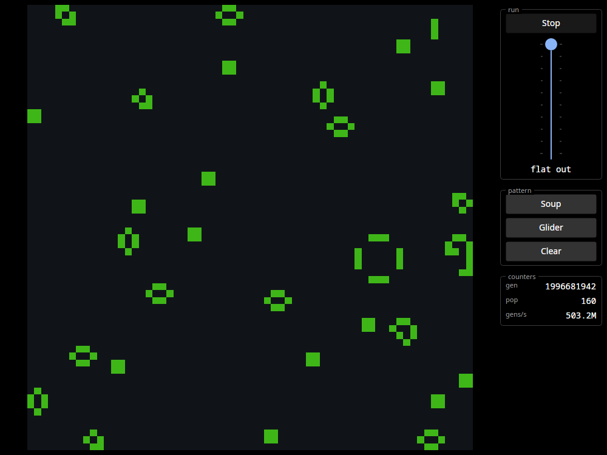

# Game of Life

A 64×64 Conway grid that updates **the entire board in one clock cycle**,
streamed to a desktop UI over a triple-buffered snapshot path. At 166.67 MHz
that is **167 million generations per second**.

*Status: on silicon. The smallest of the three accelerators and the best one to
read first.*

*`Warp11.GolView` driving the fabric flat out, 2 billion generations into a
random soup. What is left on screen is the ash — blocks, blinkers and beehives
— which at this rate it reaches within the first few microseconds.*

*The readout reads 503M generations/s because the screenshot is of the **k=3
combinational unroll**, which has since been removed. The design now advances
one generation per 166.67 MHz cycle: **167 million generations per second**.
Why it went is in `notes/STREAMING_ARCH.md` — chaining rule copies between clock
edges buys throughput until the clock or the LUTs run out, and it caps the grid
at the same time.*



## Why it is worth reading

Game of Life is the clearest demonstration of what an FPGA is actually for.

A CPU updates 4,096 cells one at a time. The FPGA builds 4,096 copies of the
cell-update logic — each one nine wires in, one wire out — and they all settle
at once. One cycle per generation, regardless of grid size, until you run out of
board.

That is the trade at its starkest: **area buys time**, and if the work is
parallel and the board is big enough, the time goes to one cycle.

## The shape of it

```
GameOfLife            the grid, and one update rule instanced per cell
  └── neighborhood    the 3×3 stencil, with an edge policy
Life64x64          the world as a design (`World.fs`, `lifeAt`): seed rows
                   in, the world a surface out, the pace as values
Life64x64Batch     the generated KV260 top: control registers, and the
  └── streamConflate3 snapshot path — triple-buffered frames out to PS DDR
```

**The stencil is a stdlib entry, not bespoke code.** `neighborhood` takes a
stencil shape and an edge policy (wrap, clamp, or a constant) and hands back the
neighbours of a cell. The same function draws Sobel's 3×3 window in the image
pipeline. That is the general pattern: an example that needs something is where
the library entry comes from.

**Conflation is what makes the UI honest.** The fabric runs generations far
faster than any display can show them, so the snapshot path keeps three buffers
and always hands the host the newest complete frame, dropping the ones nobody
could have seen. The host never waits for the fabric and the fabric never waits
for the host.

**The same world as a design, for any board** (`World.fs`, `lifeAt w h`): the
seed rows are a stream in, the world is a *surface* the host takes whole,
`tick`, `stop` and `reset` are pulses the host fires, and `tickCount`,
`intervalCycles`, `ticking`, `generation` and `population` are values. On a
board whose only connection is a UART the surface comes out as snapshots over
it — latched in one cycle when the host pulls, sent a row at a time, nothing
between pulls ever seen — which is the same conflation with the host's pull
as the pace. `-- life out/` builds it for the project's board,
`Board.board` in `Board.fs` — the KV260 at 166.67 MHz, one line to change
for another board — at the world's side, `World.side = 64`, a design
parameter stated on its own line and nothing to do with the board. The
board's gate says whether it fits: 32×32 on the Icepi, 40×40 on the
DE10-Lite; the Go Board is refused by number, 16×16 being more than its
1 280 cells. On the KV260 the world goes into a triple buffer in DDR
(`Life64x64Batch`: 32 beats a snapshot, 512-byte slots), the seed rows in
through the batch contract, and that generated top is the live app the
`gol-daemon` serves. On a board with a UART,
`warp11_snapshot --board out/ --port … --seed glider.txt --set tickCount=0
--set tick=1 --pull 10 --every 100` seeds it, runs it free and prints
what it pulled.

## Running it

In simulation, with the desktop UI:

```sh
cd hdl
P="--project Warp11.GolView.Desktop"
dotnet run -c Release $P                     # the elaborated RTL, in the Sim
dotnet run -c Release $P -- --software       # a plain F# implementation instead
dotnet run -c Release $P -- tcp/<host>:7447  # the board, over the gol-daemon
```

**The default runs the design**, which is why the view has a **Debugger** button
the moment it opens. `--software` swaps in an ordinary F# function over 64 rows
of bits — useful for comparing against, and it has no button, because there is
no design behind it to attach one to.

(`Warp11.GolView/README.md` documents two further software variants; they are
rungs of the tutorial's optimization ladder rather than anything you need here.)

## One session, many views

This is the feature the example exists to show, and it is easy to miss.

Press **Debugger** and a full step-through debugger opens on the *same running
design* the grid is rendering. Not a copy, not a replay — one `DebugSession`,
two views of it. Set a breakpoint over `population` in the debugger and the grid
stops with it; press Step and the grid advances one generation.

**The window is a presentation choice, not the mechanism.** `DebugSession` is a
first-class object that belongs to whoever makes it, and `View.debugger` is an
ordinary control. On the desktop that means a second window; in a browser, where
there are no windows, the same two views go side by side in one layout. What
makes it work is that nothing owns the simulator except the session.

### Doing this in your own project

Three pieces. The Game of Life versions are
`Warp11.GolView/HdlSimBus.fs` and `Warp11.GolView.Desktop/Program.fs`.

**1. Own the session, and hand it out.** Whatever drives your design holds the
session and exposes it:

```fsharp
let session = new DebugSession(myDesign, ownThread = not (OperatingSystem.IsBrowser()))
let live = session :> IDebugSession
do live.Sample [ "count"; "valid"; … ]     // what the view reads each publish
member _.Session = live
```

`ownThread = false` leaves the run loop unstarted for a single-threaded host to
pump; on the desktop leave it true.

**2. Open a window on it, from the composition root:**

```fsharp
let openDebugger () =
    Warp11.SimView.Program.DebugWindow(bus.Session, "my design").Show()
```

`DebugWindow(session, title)` is the side-by-side constructor — closing that
window leaves the session running.

**3. Offer the button only when there is something behind it.** The view takes
`openDebugger: (unit -> unit) option` and renders the button only for `Some`, so
a software-twin bus simply has no button rather than a broken one.

**Two things that will bite**, both solved in `HdlSimBus.fs` and neither
obvious:

- **Serialise your compound operations.** A load that pokes sixteen rows and
  steps is not atomic against a pacing thread. `HdlSimBus` wraps each in
  `lock gate`.
- **A breakpoint must stop *your* pacing too.** If your host posts `Step` calls
  on a timer, the session halting on a breakpoint will not stop that timer, and
  you will walk straight past the thing that just fired. Check it each tick:

  ```fsharp
  if running && live.Latest.hit.IsSome then running <- false
  ```

Emit and deploy:

```sh
dotnet run -c Release --project Warp11.GoL.App -- life out/    # the KV260 directory: block design, overlay, packaging, the seam
cd out && ./build.sh                                           # Vivado, the gate, the life64x64-batch app
# then gol-daemon on the board (hardware/board/README.md)
```

### Run it on

Measured, the generated world on each board (the side changed on its one
line):

| board | world | measured |
|---|---|---|
| KV260 | 64×64, through DDR | the daemon's skew canary bit-exact, 166.67 MHz |
| iCEBreaker | 8×8, over the link | two seeds × 40 generations and a 25-generation burst bit-exact against a software Life (2 196 / 5 280 cells, 32.4 MHz) |
| Icepi Zero | 32×32, over the link | 37 generations bit-exact (18 898 / 24 288 cells, 45.0 MHz) |
| Go Board | — | refused: 16×16 is 5 575 cells against 1 280 |
| DE10-Lite | 40×40, over the link | 30 generations and a 100-generation burst bit-exact against a software Life (23 846 LE, 68.3 MHz) |

## A hardware lesson this example paid for

**Never unload a bitstream while a fabric AXI master has writes in flight.**
Tearing down the PL mid-transaction leaves the PS-side write path with orphaned
beats and a *permanent* address/data pairing skew — every later write lands at
an offset. It survives reloading the app and clears only on reboot.

The symptom is very specific: frames arrive rotated by a few beats while the
populations and registers are perfect. If you see that, do not debug the RTL —
reboot the board.

The defenses are in the design: the write path is armed by a host-written
register so nothing flows before a driver arrives, and `gol-daemon … disarm`
stops it cleanly before unload. Both are there because of this bug.

## Files

- `Core.fs` — the grid and the update rule
- `Twin.fs` — the software twin the checks diff against
- `World.fs` — the world as a design: its needs, its side, its mapping
- `Board.fs` — the board the project builds for, on one line
- `../Warp11.GoL.App/` — checks, `diff`, `life`, `mapping`, `emit`, `perf`, `bench`
- `../Warp11.GolView/` — the UI and the `IGolBus` seam;
  `../Warp11.GolView.Desktop/` runs it, `../Warp11.GoL.Browser/` is the
  site's live demo of this design in the simulator
