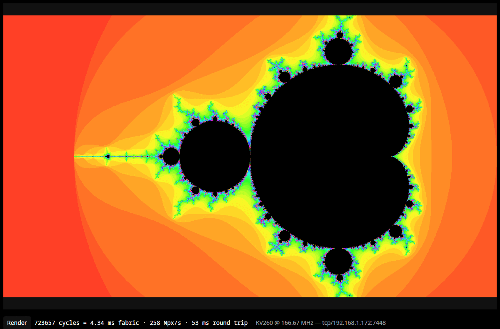

# Mandelbrot

A Mandelbrot renderer that fills every DSP on a KV260. 1400×800 at 256
iterations, **4.34 ms of fabric time** — 258 Mpx/s — with 104 lanes at
166.67 MHz, and the frame streamed straight into PS DDR.

On the [sql-mandelbrot-benchmark][bench] view that is **124× a vectorized
numpy and 255× DuckDB on an M4 Max**, end to end, from a $300 board — and
5.6× behind the same laptop's Metal GPU on a kernel-only best-of-N with no
readback. [The full field, and what each timer
wraps](#against-other-implementations-of-the-same-workload).

*Status: on silicon, bit-exact against the software twin.*

*`Warp11.MandelView` showing a frame the fabric just rendered, with the fabric's
own cycle count beside the round trip. The 53 ms is the host asking, waiting,
and pulling 1.1 MB back over the network — the render itself is the 4.34 ms.*



## The shape of it

The interesting part is not the fractal, it is the lane. A Mandelbrot pixel
takes an unpredictable number of iterations — some escape after two, some run
the full 256 — so a fixed pipeline stalls on the slow ones and a naive parallel
array idles on the fast ones.

The answer here is a **barrel-threaded lane**: one arithmetic pipeline shared by
the pixels in flight, one advancing per cycle in rotation. The multiplier is
busy every cycle regardless of how the pixels are behaving, because there is
always some other pixel ready to advance. When a pixel escapes, its slot is
refilled from the next without disturbing the others.

That makes the design DSP-bound rather than control-bound, which is why it
scales until the board runs out of DSPs — and it does exactly that, at 104
lanes using all 1,248 of them.

The frame is a stream of **chunk beats**: `coords` turns each into the view
of a 128-pixel run of a row, and the run goes to whichever lane is free. A
lane answers with eight beats of sixteen pixels, each carrying **the place
it belongs**, so no lane waits on another — the lanes finish in any order
and the frame still lands whole.

```
beat ──▶ coords ──cx0 cy dx──▶ mandelChunkAddressed × 104 ──index, pixels──▶ out
  cxOrigin cyOrigin dx dy (controls = registers)       16 px a beat, and where it goes

mandelChunkAddressed    one lane at one chunk wide
  ├── MandelCoordGen          the chunk's pixels
  ├── MandelBarrelLane        8 pixels in flight
  └── MandelRowCoalescer      16 pixels per 128-bit beat
```

**Coalescing is not an optimization, it is the reason the design is possible.**
A single-beat AXI write per pixel caps out around 25 Mpx/s — an order of
magnitude below what the lanes produce. Sixteen pixels per 128-bit beat is what
lets the fabric keep up with itself.

The boundary is the batch contract's **counted** path: nothing is read; the
host writes the chunk count and the view, and each beat is written at its
place — into the KV260's DDR by address. On a board whose only wire is a
UART the beats come back as the index then the pixels, and the host places
them (`warp11_batch frame:… --serial …`), refusing a frame with a place
filled twice or never; the index is a fifth word every sixteen pixels.

`Chunked.fs` is the design. The numbers a host has to agree with — the
frame's width, the chunk, the iteration cap, the view's fraction bits — are
stated there as facts and reach the host in the seam (`FRAME_WIDTH`,
`CHUNK_PIXELS`, `MAX_ITERATIONS`, `FRACTION_BITS`), so the daemon reads
them rather than writing them down. The board is `Chunked.board`, one line
(`kv260At fabricHz`); change it and the same verb builds for another, with
the lanes that part holds — its multipliers at twelve a lane, or its logic
at the lane's measured cost, whichever binds first: 104 on the KV260, 2 on
the Icepi, 10 on the DE10-Lite (whose lanes keep their per-thread state in
block RAM, having no LUT RAM). `Chunked.mapping` scatters into the host's
memory where the board has one and counts over its link where it does not.

## Running it

In simulation, no board required:

```sh
cd hdl
dotnet run -c Release --project Warp11.Mandelbrot            # the living checks
```

The bitstream, and the board:

```sh
dotnet run -c Release --project Warp11.Mandelbrot -- bitstream out/   # the KV260 directory: Verilog, block design, overlay, seam
out/build.sh                                                          # Vivado, the gate, the app in out/app
# copy out/app to the board as build.sh prints, then on the board
sudo xmutil unloadapp && sudo xmutil loadapp mandelbrot-batch
./mandel-daemon --board mandelbrot_batch --layout mandelbrot_batch_layout.rs check
```

`check` is the bring-up: one render compared byte for byte against the
software twin, and its fabric cycles; exit 0 only if every pixel matches.
Without it the daemon serves the live view
(`hardware/board/mandel-daemon.service`), reading the same seam. A frame
straight to a file is `warp11_batch frame:1400x800 out.pgm --board
mandelbrot_batch --layout mandelbrot_batch_layout.rs --chunk 128 --set
cxOrigin=…`.

See [docs/dev-workflow.md](../../docs/dev-workflow.md) for the deploy path.

## Files

- `Mandel.fs` — one iteration, the barrel-threaded lane around it, the
  coalescer that packs 16 pixels into a 128-bit beat, the coord-gen, the
  lane pod, and the chunk as a unit
- `Chunked.fs` — the frame: the design, its facts, its mapping, its Sim
  runs through the KV260's top and the Icepi's link
- `Harness.fs` — the pieces at ports, for the oracle
- `Pod.fs`, `FramePod.fs` — the mini pod and a row-sweeping frame pod built
  from the same lane, kept as oracle inputs; `Host.fs`, `FrameHost.fs` —
  their Sim renders, and `lanescale`
- `Units.fs` — the units a drawn design may name
- `Main.fs` — the living checks, `bitstream`, the simulation probes

## Numbers, and where they come from

All measured on the board on 2026-11-09 at the default view (the whole set,
1400×800, 256 iterations), by `mandel-daemon … bench` — two renders, the
frame read back every way below, the mappings asserted equal, the twin
compared — and through the daemon and the live view. Nothing here is
projected.

### The render

| | |
|---|---|
| fabric | **723,470–725,673 cycles = 4.34–4.35 ms** — 258 Mpx/s, eighteen renders |
| clock | 166.67 MHz, 104 lanes, 1,248 DSPs, WNS +0.422 ns after route |
| host wall, start to done incl. polling | 4.35 ms |
| correctness | **0 mismatches of 1,120,000 pixels** against the software twin, every render |

The count moves by a few hundred cycles from one render to the next: the
lanes finish in whatever order the iterations make them, and when the DDR
port accepts a beat is not the same twice.

### Getting the frame back, three ways

The frame is 1.1 MB in PS DDR, and how you read it matters more than it
looks. Same bytes, same run, three mappings (two runs):

| path | time | rate |
|---|---|---|
| uncached, `O_SYNC` mmap | 9.6–10.5 ms | 107–117 MB/s |
| cached mmap + `sync_for_cpu`, cold | 2.1 ms | 526–531 MB/s |
| cached mmap + `sync_for_cpu`, warm | **0.97–1.03 ms** | **1,096–1,158 MB/s** |
| cached, pure read (a `u64` sum, no stores) | 0.47–0.51 ms | 2,204–2,389 MB/s |

**The uncached path is 10× slower than the cached one**, which is why the
daemon uses the cached mapping and an explicit `sync_for_cpu` rather than
the always-correct `O_SYNC` baseline. `bench` asserts the two byte-equal,
so the fast path is checked rather than trusted. The pure-read row
separates the mapping's bandwidth from memcpy's character: about half the
warm copy's time is the store side, not the read.

So end to end, fabric plus readback:

| | |
|---|---|
| uncached | 13.9–14.8 ms |
| **cached + sync** | **5.32–5.38 ms** |

### Live, over the network

Through `mandel-daemon` and `Warp11.MandelView` (§ [MandelView](../Warp11.MandelView/README.md)):

| | |
|---|---|
| round trip | **53–75 ms**, eight consecutive renders |
| on the wire | 1,120,000 bytes per frame, cropped from the padded 1408 stride |

**The wire is the bottleneck, not the fabric — over 10×.** A 4.3 ms render
moving 1.1 MB over TCP is a network benchmark with an accelerator attached,
which is worth knowing before anyone designs an interaction that assumes
frames are cheap to ship. The figure moves with the network: the first frame
the same evening took 109 ms.

### Against other implementations of the same workload

The [sql-mandelbrot-benchmark][bench] suite times CPU, SQL and GPU
implementations of *this exact view* — 1400×800, 256 iterations,
x∈[−2.5,1.0], y∈[−1.0,1.0] — on a **MacBook Pro M4 Max**. The detail that
decides whether a comparison is honest is **what each timer wraps**:

- **CPU / SQL** (numpy, Arrow, DuckDB, …): wall time around the whole call,
  **until the full iteration array exists in host RAM** — single run, end to
  end.
- **GPU (Metal)**: the kernel dispatch → `waitUntilCompleted` only —
  **best-of-N**, warm, buffer allocation and shader compilation excluded,
  **no readback**. The benchmark's own README calls it *"unfair, but the
  true limit."*

So there are two anchors, and each row is compared against the one that
matches it:

| | Implementation | Hardware | What's timed | Time | Warp factor † |
|---|---|---|---|---:|---:|
| — | **Warp 11 (this work)** | **KV260 (~$300)** | **end to end** (compute → DDR → host) | **5.35 ms** | 1× |
| — | Warp 11 (this work) | KV260 | fabric compute (frame in DDR) | 4.34 ms | 1× |
| 🏎 | Apple Metal GPU | M4 Max | GPU kernel only, best-of-N, no readback | 0.77 ms | 0.18× |
| 1 | NumPy (vectorized) | M4 Max CPU | end to end | 665 ms | **124×** |
| 2 | ArrowDatafusion SQL | M4 Max CPU | end to end | 797 ms | **149×** |
| 3 | DuckDB SQL | M4 Max CPU | end to end | 1,364 ms | **255×** |
| 6 | Pure Python | M4 Max CPU | end to end | 4,328 ms | **809×** |
| 7 | SQLite SQL | M4 Max CPU | end to end | 44,918 ms | **8,396×** |

† Benchmark time ÷ the *comparable* Warp 11 time — end-to-end for the
CPU/SQL field, fabric-compute for the GPU's kernel-only figure. Above 1×
means Warp 11 is faster. The end-to-end figure is the middle of the two
`bench` runs' 5.32 and 5.38 ms.

**Against the fair field it wins by two orders of magnitude** — 124× numpy,
255× DuckDB, on a $300 embedded board against a top-tier laptop. **Against
the GPU's compute-only "true limit"** it is 5.6× behind, on a warm
best-of-N kernel with no data movement, on far more die, power and price.

Two honest caveats in the other direction. A bigger FPGA with more DSP and
HBM clears 0.77 ms outright — this part ran out of DSPs at 104 lanes, not
out of architecture. And at deep zoom, where you need more than FP64, the
GPU cannot compete at all while an FPGA just widens its fixed point.

### Number-format precision

The CPU/SQL benchmarks compute in **FP64** (the language default); the Metal
GPU in **FP32**. Warp 11 uses **Q4.28 signed fixed point** — 28 fractional
bits, which sits *between* FP32's 24 and FP64's 52. This is not a
lower-precision shortcut: at 256 iterations on this view all three formats
produce **identical escape counts everywhere**, so precision is not the
limit, iteration count is.

Q4.28 is the honest sweet spot rather than a compromise — it maps to one
DSP48-friendly 32×32 multiply and avoids the ~10× DSP cost of floating point
on FPGA. Matching FP64 exactly is a parameter widen to 64-bit fixed, the
FPGA's native move, not an IEEE-FP build.

### The gap that is left

The fabric time is 90.8% of the lane-limit ideal for this view — 657,167
cycles, every lane advancing a pixel-iteration every cycle, from the twin's
own iteration count. The rest is each lane's barrel draining its tail at the
end of every chunk, and the write port's backpressure, filed rather than
fixed.

One limit worth naming because it is not obvious from the numbers:
**`maxIterations` is fixed at 256 in the elaborated design**, so zooming toward the
boundary saturates — every pixel hits the cap and the frame goes black.
That, not the Q4.28 coordinate format, is what bounds useful zoom depth, and
it is why the live view ships without one.

[bench]: https://github.com/Zeutschler/sql-mandelbrot-benchmark
